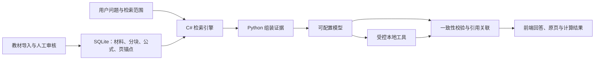

# 多模态知识一致性校验与可追溯问答系统

面向课程教材的可追溯问答工作台。系统先检索教材证据，再调用可配置的大模型生成回答，并对文字、公式、数值/单位和波形/频谱执行确定性检查。

项目采用 **React + TypeScript、FastAPI + Python、SQLite、C#/.NET 10**，适合课程设计、教材问答和 RAG 原型研究。

## 主要能力

- **教材导入与审核**：解析 PDF、DOCX 或 Markdown，保留页码、章节、公式和图表定位；OCR 或模型辅助结果先进入待审核状态。
- **可追溯 RAG**：回答携带材料 ID、页锚点和审核状态，支持展开原文、预览 PDF 页面和同书图表。
- **混合式查询理解**：默认使用可解释的关键词与中文 n-gram 检索；学生使用口语或同义表达时，可让已配置的大模型补充教材术语。原始查询始终保留。
- **四类一致性检查**：文字/概念、公式关系、数值/单位、波形/频谱。超出可靠判断范围时返回 `unknown`，不把未知误判为错误。
- **受控科学工具**：支持波形、傅里叶分析、频率响应和离散卷积。模型只提交结构化计划，计算由固定的本地 Python worker 执行。
- **会话与历史**：草稿、会话、教材依据、工具结果和检查快照相互关联，可恢复和删除。
- **前后端分离部署**：Nginx 提供前端静态文件，FastAPI 负责 API；C# 检索 worker 作为后端容器内的常驻进程运行。

## 系统架构



### 技术职责

- **React / TypeScript**：问答界面、教材范围、会话、Markdown/KaTeX、证据和工具结果展示。
- **Python / FastAPI**：API、数据库、教材导入审核、模型适配、工具编排和四类校验。
- **C# / .NET 10**：检索快照、Unicode 规范化、候选召回、关键词评分、过滤、查询扩展融合和来源去重。它是检索实现，不是简单的进程转发器。
- **SQLite**：保存课程、教材、材料分块、公式、会话、答案、核验结果和检索版本。

## 快速开始

### 环境要求

- Python 3.13+
- .NET 10 SDK
- Node.js 18+
- 可选：Docker Compose
- 可选：OpenAI-compatible Responses API provider

### 1. 安装后端依赖并发布 C# 检索程序

PowerShell：

```powershell
python -m venv .venv
.\.venv\Scripts\Activate.ps1
python -m pip install -r backend\requirements.txt

dotnet publish rag-engine/Rag.Search/Rag.Search.csproj `
  -c Release -o rag-engine/publish
```

### 2. 初始化并启动 API

首次运行演示数据时：

```powershell
python -m backend.seed --reset
```

启动后端：

```powershell
python -m uvicorn backend.app.main:app --reload --port 8000
```

API 文档：<http://127.0.0.1:8000/docs>

### 3. 启动前端

```powershell
cd frontend
npm install
npm run dev
```

前端默认访问 <http://127.0.0.1:5173/>。如需指定 API 地址：

```powershell
$env:VITE_API_BASE_URL = "http://127.0.0.1:8000/api"
```

没有配置模型时，系统仍可进行本地教材检索和本地回退；需要模型生成、查询扩展或学习建议时，必须提供有效的 provider 配置。

## 模型配置

系统使用 OpenAI-compatible **Responses API**。可以通过环境变量或管理页面配置 provider：

```dotenv
LLM_PROVIDER=your-provider
LLM_BASE_URL=https://your-provider.example/v1/responses
LLM_API_KEY=replace-with-your-key
LLM_MODEL=your-model
LLM_GATEWAY_MESSAGES=false
LLM_CONFIG_SOURCE=environment
```

可选配置：

```dotenv
DATABASE_URL=sqlite:///data/knowledge.db
WEB_SEARCH_ENABLED=false
WEB_SEARCH_URL=
WEB_SEARCH_API_KEY=
RAG_ENGINE_PATH=rag-engine/publish/Rag.Search.dll
RAG_DOTNET_EXECUTABLE=dotnet
RAG_WORKER_TIMEOUT=30
ADMIN_API_TOKEN=replace-with-a-local-admin-token
```

- 不要把 API key、管理口令或包含它们的配置文件提交到 Git。
- provider 配置保存在本地运行数据中；前端只获得脱敏后的 provider 和模型信息。
- 网络搜索结果与本地教材证据分开记录，网络内容不会伪装成教材页码依据。

## 教材导入与发布

网页导入适合交互式审核：进入管理页面的“教材导入”，上传 PDF、DOCX 或 Markdown，检查页码、正文、公式和图表候选后再发布。

命令行导入：

```powershell
python -m backend.import_textbooks .\path\to\textbook.pdf --course-id 1
```

扫描页需要显式指定 OCR 页码：

```powershell
python -m backend.import_textbooks .\path\to\scanned-book.pdf `
  --course-id 1 --ocr-pages 1,2,3
```

为导入任务建立 RAG 页面索引：

```powershell
python -m backend.build_rag --job-id 1 --course-id 1
```

推荐的审核流程：

1. 导入教材并查看任务状态。
2. 检查正文、章节、公式、图表和页码。
3. 对 OCR 或模型辅助结果进行人工修订。
4. 将可信候选标记为已审核。
5. 发布审核结果，再通过检索和问答检查来源定位。

未审核材料可以作为候选进入索引，但会保持 `verified=false`；撤销材料不会参与回答检索。系统不会把空 OCR 或模型猜测直接发布为教材事实。

## API 入口

| 方法 | 路径 | 用途 |
| --- | --- | --- |
| `POST` | `/api/search` | 检索教材证据 |
| `POST` | `/api/answers/ask` | 基于 RAG 生成并校验回答 |
| `POST` | `/api/answers/validate` | 校验用户提供的答案 |
| `GET` | `/api/materials/{id}/evidence` | 查看完整教材依据 |
| `GET` | `/api/source-documents/{id}/pages/{page}/image` | 查看原始 PDF 页面 |
| `GET` | `/api/tool-artifacts/{id}` | 查看受控工具生成的 PNG |
| `POST` | `/api/ingestion/upload` | 上传教材并创建导入任务 |
| `GET` | `/api/ingestion/jobs/{id}/rag` | 查看教材 RAG 覆盖状态 |
| `GET` | `/api/metrics` | 查看评测覆盖信息 |

完整请求和响应以 `/docs` 中的 OpenAPI 定义为准。

## RAG 与检索实现

RAG 的流程是“检索教材片段 → 将片段交给模型 → 校验回答并关联引用”，不是训练或微调模型。

- C# 使用精确关键词和中文连续 n-gram 检索，不依赖 embedding、向量数据库或 BM25。
- 常驻索引使用二字 posting 缩小候选，再执行精确的非重叠匹配和评分。
- 支持课程、主题、教材、材料类型和材料 ID 过滤，并按来源去重。
- 材料或分块发生变化时更新检索版本；普通聊天不会重建教材索引。
- 查询扩展最多补充三条受约束的教材术语。原问题单独保留，扩展结果经过相同范围和撤销过滤。
- 最终引用只能来自实际送入模型的本轮证据；引用存在不等于每个数学主张都已被证明。

## 一致性校验与本地工具

### 校验

- **文字/概念**：检查回答与教材证据的关联。
- **公式/关系**：使用有界解析和显式符号构造比较常见代数关系。
- **数值/单位**：进行单位归一化、量纲和标准值比较。
- **波形/频谱**：对支持范围内的计算结果和图表信息进行检查。

缺少可信参考或超出解析范围时返回 `unknown`，而不是强行返回 `fail`。

### 工具

| 工具 | 能力 |
| --- | --- |
| `waveform` | 连续或离散函数波形 |
| `fourier` | 支持函数族的解析变换或明确标注的有限窗近似 |
| `frequency_response` | 模拟/数字有理系统的幅频、相频和零极点信息 |
| `convolution` | 带起点索引的有限序列完整线性卷积 |

工具执行具有固定 schema、白名单表达式、请求大小限制、调用次数限制、时间限制和采样点限制；不执行模型生成的任意 Python、Shell 或文件操作。工具错误和模型解释失败会被明确保留，不伪装成成功结果。

## Docker 部署

Compose 部署包含两个服务：前端 Nginx 和后端 FastAPI。C# worker 与 .NET runtime 位于后端容器内。数据库、教材、审核数据、工具图片和本地配置通过 `runtime/` 持久化，不打入镜像。

准备运行数据目录：

```powershell
New-Item -ItemType Directory -Force runtime\data
# 创建 runtime/.env，并填入本地模型配置；不要提交该文件
```

构建并启动：

```powershell
docker compose up -d --build
```

默认访问 <http://127.0.0.1:12345/>，健康检查为 `/api/health`。可通过环境变量修改绑定地址和端口：

```dotenv
APP_BIND_HOST=127.0.0.1
APP_PORT=12345
APP_UID=1000
APP_GID=1000
```

生产部署前请自行配置反向代理、TLS、备份、日志和访问控制；仓库不包含任何共享服务器地址或运行凭据。

## 测试与构建

后端：

```powershell
python -m pytest -q backend/tests
```

前端：

```powershell
cd frontend
npm test
npm run build
```

C# 检索协议测试：

```powershell
dotnet run --project rag-engine/Rag.Search.Tests/Rag.Search.Tests.csproj -c Release
```

## 已知限制

- 关键词检索和模型查询扩展仍可能漏掉完全不同措辞的内容；它不是向量语义检索。
- OCR、扫描页和原书排版问题需要人工审核；审核通过不代表教材原文绝对无误。
- 公式校验只覆盖受支持的表达式和关系，`unknown` 不是错误证明。
- 有限窗 FFT 是近似结果，系统会保留相应限制说明。
- 模型调用受 provider 的网络、配额和速率限制影响；系统不会把上游失败伪装成成功回答。
- 当前问答接口是一次性 HTTP 响应，不承诺 SSE 逐字流式输出。

## 数据与隐私

- 教材 PDF、数据库、审核清单、工具图片和模型配置默认属于本地运行数据，不应提交到公开仓库。
- API key、管理口令和 provider 配置只放在环境变量或未跟踪的本地配置文件中。
- 上传教材前确认拥有相应使用和分发权限；不要把受版权保护的教材或完整 OCR 文本发布到公开仓库。
- 公开部署时请自行设置身份认证、HTTPS、备份策略和访问控制。

## 目录概览

```text
backend/                  FastAPI、数据库、导入、校验和工具
frontend/                 React/Vite 前端
rag-engine/               C#/.NET 10 检索引擎及协议测试
deploy/                   Docker 构建文件
compose.yaml              本地 Compose 部署
configs/                  可审查的导入/审核清单示例
data/                     本地运行数据；教材和密钥不应提交
```

## 贡献

欢迎提交 Issue 或 Pull Request。涉及教材、模型配置、运行数据和安全边界的改动，请同时说明数据来源、权限范围和验证方式。
