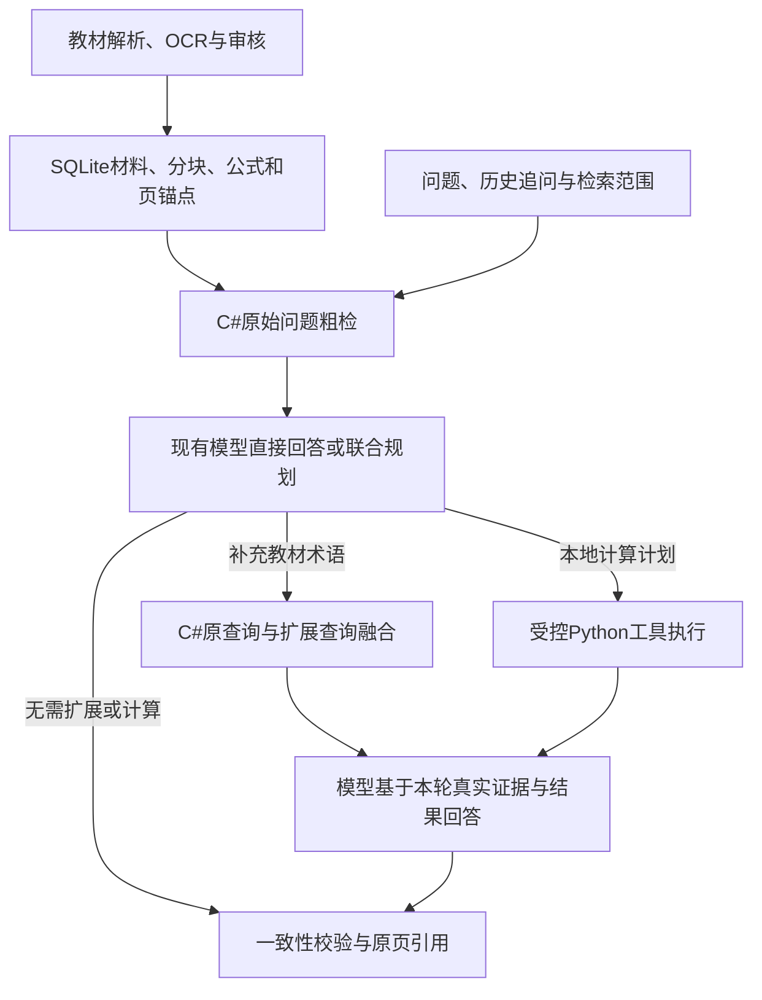

# 多模态知识一致性校验与可追溯问答系统

课程设计项目：FastAPI + SQLite + C#/.NET 10 检索引擎 + React/Vite。系统以课程资料为检索证据，对回答执行文本、公式、数值/单位、波形/频谱四类检查，并返回可定位来源、置信度、风险提示和 Agent 工作流记录。

## 当前资料状态

仓库中已发现四本 PDF 教材：

- 数字信号处理教程（第五版）
- 信号与系统
- 模拟电子技术基础
- 数字电子技术基础

首次导入结果会进入“待审核”状态。数字信号处理 PDF 有可读取的 OCR/文本层；另外三本主要是扫描页，系统会记录 `ocr_required`，不会把空 OCR 结果发布为知识库事实。视觉模型不可用时必须人工补录或审核。

## Docker 部署

生产部署使用独立 Compose 项目 `knowledge-qa-12345`：Nginx 提供前端静态文件并将同源 `/api` 转发给 FastAPI，只有前端端口对宿主机开放。数据库、教材、审核侧车、历史计算图像和模型配置通过 `runtime/` 持久化，不放进镜像或 Git。

### 导出已有资料与配置

在原项目根目录执行，输出目录必须是全新的：

```powershell
python -m backend.export_runtime --output runtime --include-config
```

导出使用 SQLite 在线备份，源数据库可继续运行；只在副本中把教材路径改为 `/app/data/uploads/` 下的 ASCII 文件名，核对原 PDF SHA256，保留问答、审核、原文、索引和公式。仅复制数据库引用的审核 JSON、原教材和历史工具 PNG，完成后写入 `runtime-manifest.json`；失败不留下可误用的“完成”清单，已有目录不会被覆盖。

`--include-config` 显式携带现有 `.env`、provider 配置和已有管理口令；省略时不导出这些秘密，也不修改源配置。POSIX 导出目录权限为700、文件为600，Windows 访问控制仍由系统 ACL 管理。通过 SSH/SFTP 单独传输 `runtime/`，Linux 解压时使用 `umask 077`；不要执行 seed/reset 或用空目录覆盖现有运行数据。

### 启动与运维

服务器项目目录为 `/home/wgh/knowledge-qa-12345`，在该目录创建仅含部署参数的 `deploy.env`：

```dotenv
APP_BIND_HOST=10.102.7.77
APP_PORT=12345
APP_UID=1000
APP_GID=1000
```

`runtime/` 必须属于这里指定的运行用户；该服务器 `wgh` 的 UID/GID 均为1000。没有指定部署参数时，端口默认只绑定 `127.0.0.1:12345`。

```bash
docker compose --env-file deploy.env -p knowledge-qa-12345 up -d --build --wait --wait-timeout 300
docker compose --env-file deploy.env -p knowledge-qa-12345 ps
docker compose --env-file deploy.env -p knowledge-qa-12345 logs --tail 100
docker compose --env-file deploy.env -p knowledge-qa-12345 restart
```

访问 `http://10.102.7.77:12345/`，健康检查为 `/api/health`，管理页面为 `/admin`。上述命令仅作用于该独立项目，不使用宿主机网络、外部 Compose 网络或 Docker socket，不重启其他服务。后端以非root用户运行，运行资源上限为2 CPU/2GiB，前端为0.5 CPU/256MiB；日志轮转、健康检查和 `unless-stopped` 重启策略均已配置。

Docker 构建约束 `numpy<2.4`：该服务器虚拟 CPU 缺少 NumPy 2.4 起要求的 [x86-64-v2 指令集](https://numpy.org/doc/2.4/release/2.4.0-notes.html)，不通过修改宿主机或关闭检查规避；实际镜像内 NumPy 2.3.5、非root OCR 和科学绘图已运行通过。前端生产构建和渲染回归不依赖本机私有教材 JSON。

镜像使用 .NET 10 SDK 构建 `rag-engine/Rag.Search`，只把编译产物和 .NET runtime 放入后端镜像；C# worker 是同一后端容器内的常驻子进程，不增加容器、对外端口或数据库写入者。宿主机不用安装 .NET；本地源码运行则先按下节发布 C# 产物。

在服务器终端获取管理口令，填入管理界面的“管理口令”即可解锁；这不会改写模型 API key：

```bash
docker compose --env-file deploy.env -p knowledge-qa-12345 exec -T backend python -c "from backend.app.provider_config import get_admin_token; print(get_admin_token())"
```

运行期间也可生成新的完整备份，仍不覆盖已有输出：

```bash
docker compose --env-file deploy.env -p knowledge-qa-12345 exec -T backend python -m backend.export_runtime --output "/app/data/backups/$(date +%Y%m%d-%H%M%S)" --include-config
```

首次部署曾验证97条答案、18个会话的完整副本，保留备份 `runtime/data/backups/deployment-verified/`。C# 更新使用服务器当时的81条答案及3个会话原地迁移，未用本地历史覆盖服务器；临时验收对话删除后，所有原表行指纹和 key 字节不变，只新增 `retrieval_revision`。此次基线中的16个其他服务容器 ID、镜像、启动时间、重启计数和端口均未变。服务器使用独立数据副本，不与本地自动双向同步。

## 后端启动

Python 3.13 已验证；建议使用虚拟环境：

```powershell
python -m venv .venv
.\.venv\Scripts\Activate.ps1
python -m pip install -r backend\requirements.txt
```

同时安装 .NET 10 SDK，在项目根目录发布实际检索程序：

```powershell
dotnet publish rag-engine/Rag.Search/Rag.Search.csproj -c Release -o rag-engine/publish
```

运行时需要 .NET 10。`RAG_ENGINE_PATH` 默认为 `rag-engine/publish/Rag.Search.dll`，`RAG_DOTNET_EXECUTABLE` 默认为 `dotnet`，`RAG_WORKER_TIMEOUT` 默认为30秒；这些设置不包含模型 key，不必改写现有 `.env`。检索程序不可用时明确返回503 `retrieval_unavailable`，不静默退回 Python 排名或伪装为空证据。

初始化演示资料（会重置本地 `data\knowledge.db`，应在教材导入前执行）：

```powershell
python -m backend.seed --reset
```

启动 API：

```powershell
python -m uvicorn backend.app.main:app --reload --port 8000
```

打开 `http://127.0.0.1:8000/docs` 可查看 OpenAPI 文档。

- `GET /api/source-documents?course_id=...`：查看教材文件和 RAG 覆盖状态。
- `POST /api/search`：本地教材检索；可用 `source_document_id` 限定到一本教材。
- `POST /api/answers/ask`：按选定 provider/模型使用本地 RAG，必要时执行受控的本地计算/绘图并将实际结果交给模型解释，随后执行确定性校验；可传 `conversation_id` 继续同一对话，以 `source_document_id` 限定教材。
- `POST /api/answers/validate`：校验用户提供的答案。
- `GET /api/answers/{answer_id}`：读取可复现答案记录。
- `POST /api/conversations`、`GET /api/conversations`、`GET /api/conversations/{id}`：显式创建、列出和恢复独立对话；列表仅返回已经有问答轮次的对话，不删除历史空记录。前台首次提问前只创建本地草稿。
- `POST /api/conversations/titles`：按 `conversation_ids`（每批最多32个）调用所选模型概括既有对话的首轮问答；仅更新待生成标题，不改变对话时间、问答内容或校验快照。
- `DELETE /api/conversations/{id}`：删除指定对话及关联问答、溯源、核验和不再被其他答案引用的工具 PNG；成功返回204，不存在返回404，不影响教材与其他对话。
- `POST /api/study-suggestions`：使用所选 provider/模型，从当前课程、主题、教材范围内的已审核真实教材生成三个学习问题；支持 `exclude` 排除上一组，不使用固定问题兜底。
- `GET /api/tool-artifacts/{artifact_id}`：读取问答本地计算产生的真实 PNG，仅接受不透明的图像 ID，不接受文件路径。
- `GET /api/materials/{material_id}/evidence`：读取当前校订的完整教材依据、格式及同书图表定位，不截断为检索片段。
- `GET /api/source-documents/{document_id}/pages/{page_number}/image`：预览原始 PDF 页面，页码从 1 开始。
- `GET /api/materials/{material_id}/media/{figures|tables}/{index}`：读取经审核的原页图表裁剪；坐标按页面显示方向归一化，支持旋转页，不修改 PDF。
- `GET /api/metrics`：返回真实评测覆盖和指标。
- `POST /api/ingestion/upload`：上传新教材并生成待审核任务。
- `GET /api/ingestion/jobs/{job_id}`：查看解析任务、候选页面和异常页。
- `POST /api/ingestion/jobs/{job_id}/quality-audit`：重新读取原始 PDF，审计遗留导入的页面质量并撤销不可信旧证据。
- `POST /api/ingestion/jobs/{job_id}/build-rag`：为任务的全部非空页面建立可追溯 RAG 索引；未审核页面以 `indexed_unverified` 候选状态进入检索，不伪装为已审核事实。
- `GET /api/ingestion/jobs/{job_id}/rag`：读取整书索引页数、coverage、verified/candidate 页数和 chunk 数。
- `POST /api/ingestion/items/{item_id}/ocr`：对指定扫描页执行本地 RapidOCR，结果仍需审核。
- `POST /api/ingestion/items/{item_id}/assist?mode=auto|text|vision`：调用可选文本/视觉模型辅助解析；结果仍是 pending。
- `PATCH /api/ingestion/items/{item_id}`：审核、修改或拒绝候选。
- `POST /api/ingestion/jobs/{job_id}/publish`：只发布非空且明确审核通过的候选。

## 导入教材
网页导入：启动后端和前端，进入“教材导入”，选择课程并上传 PDF/DOCX/Markdown。系统先解析页码、章节、正文、公式候选和图片数量；扫描页显示“需要 OCR/视觉辅助”，不自动发布。

命令行导入已有文件：

```powershell
python -m backend.import_textbooks ".\数字信号处理教程（第五版） (程佩青) (z-library.sk, 1lib.sk, z-lib.sk).pdf" --course-id 1
```

为已有任务建立整书 RAG 页面索引：

```powershell
python -m backend.build_rag --job-id 1 --course-id 1
```

该命令会为每个有文本的页面创建或更新一个 `source_anchor=doc:<document_id>:p<page>` 材料及其 chunks。页面即使尚未人工审核，也只会以 `verified=false`、`publication_status=indexed_unverified` 进入候选检索；回答置信度会提示“尚未完成教材审核”，不会把候选冒充成已确认教材事实。审核通过后再调用 `publish`，材料才转为已发布状态。

扫描页只在显式指定时执行本地 OCR，避免首次导入阻塞：

```powershell
python -m backend.import_textbooks ".\信号与系统 (孙国霞) (z-library.sk, 1lib.sk, z-lib.sk).pdf" --course-id 2 --ocr-pages 31,32
```

推荐流程：
1. 先导入一章或一本教材，读取 job 状态；
2. 检查章节、页码、正文和公式候选；
3. 对扫描页调用单页 OCR、配置视觉模型辅助或人工填写；
4. 对公式、数值、波形/频谱字段人工核验；
5. 将候选标为 `approved`；
6. 调用 publish；
7. 再通过检索和问答验证来源定位。

### 独立整书全文导入

导入器不依赖助手、浏览器或对话状态。对已经登记的教材，可使用 `configs/remaining-library.json` 一次选择其余三本书，默认读取前台当前默认 provider/模型，不写模型配置或 API key：

```powershell
python -u -m backend.import_library `
  --manifest .\configs\remaining-library.json `
  --mode auto --workers 2 `
  --output-dir .\data\library-model-import
```

- `auto` 对扫描页发送真实原页图像；只有上游明确不支持图像时才使用真实 OCR 后的文本转写。`vision` 强制原页图像；`text` 使用实际文本/OCR。模型返回必须是完整页，不接受摘要、空响应、截断 JSON 或未配对数学定界符。
- 正文是公式的唯一来源：候选公式由完整数学段提取，避免模型重复抄写正文和公式列表导致两份表达式不一致。图表提议仍须原页审查，模型置信度不授权发布。
- 每页独立事务及不可变检查点。重复命令从成功检查点恢复；PDF、原始文本、模型/模式、OCR 引擎版本变化会使旧检查点失效。`--pages 31 32` 选择明确的 PDF 页；`--force` 生成新版本但不覆盖已审核或人工修改的页。
- 输出 `library.review.json` 兼容 `backend.build_knowledge --approve-manifest ... --publish`。页码、页锚点、PDF SHA256 和原始文本 SHA256 均受校验；`raw_text`、原 PDF、已审核版本及历史证据 ID 保留。
- 导入错误会保存逐页失败类型、有限且脱敏的上游诊断和未信任转写提议；非零退出码表示未完整完成。401/404 不被当作本地成功，也不自动修改 key。仅批量传输/限流重试遵守 `Retry-After`，不改变前台问答的重试策略。

不使用上游模型时，必须明确选择本地模式，不会静默回退：

```powershell
python -u -m backend.import_library `
  --manifest .\configs\remaining-library.json `
  --mode ocr --workers 2 `
  --output-dir .\data\library-local-ocr
```

本地模式使用 Python 3.13 兼容的 RapidOCR 3.x / ONNX Runtime，保留真实识别框、阅读顺序和段落；不加载 provider 或联网请求。结果和公式仍是未审核候选，OCR 错字必须对照原页修订。空 OCR 只有整页严格近白且无原生文字时才记录为待审核空白页；灰边、噪点、封面或图像页不能自动冒充空白。扫描空白/纯图页需明确原页视觉审核及匹配的 raster SHA256，无可检索文字时不制造正文或 chunks。`jobs/{id}/rag` 分开报告检索页数与已审核空白/纯图页数。


## 可重复知识库构建
不依赖 OMP 或浏览器；平台部署后可直接用命令行完成“解析 → 生成审核清单 → 人工确认 → 发布”。示例清单位于 `configs/dsp-sampling.json`：

```powershell
python -m backend.build_knowledge `
  --manifest .\configs\dsp-sampling.json `
  --output .\configs\dsp-sampling.review.json
```

构建阶段只创建/复用导入任务、按 `ocr_pages` 执行显式 OCR，并输出带教材哈希、页码、`source_anchor`、原文哈希和候选内容的 review manifest；不会自动发布。模型辅助只有在清单填写 `assist_pages` 时才调用，失败会记录到 `errors` 并保留待审核状态。

默认保持人工确认。若某个 job 显式设置 `"auto_approve_low_risk": true`，构建器只会自动批准原生纯文本：`item_type=text`、无 OCR/模型标记、无可识别数字或数量单位、无公式、无图片、原文与规范化文本一致且提取置信度不低于 `0.7`；自动项会写入 `approval_method=auto_low_risk_text`。公式、数值、波形、频谱、OCR 低置信度和模型整理结果不会走这条自动通路，仍进入审核清单。

人工检查 review manifest，将确认的条目标记为 `"approved": true`，再执行：

```powershell
python -m backend.build_knowledge `
  --approve-manifest .\configs\dsp-sampling.review.json `
  --publish
```

审批阶段会校验教材文件哈希、页码、来源锚点和原文哈希；源文件发生变化时拒绝发布。重复执行按文档哈希、页码和 `source_anchor` 幂等，不会重复创建材料。审核清单可能包含教材摘录，默认不提交到 GitHub；应在部署环境单独保存或由课程组审核后管理。

GitHub 只同步代码、说明和白名单中的无密钥进度报告：`data/library-import-run-report.json`、`data/library-review-integration.json`、`data/library-source-math-report.json`、`data/library-ui-smoke.json`、`data/rag-writing-audit.json`。环境配置、provider 密钥配置、管理口令、数据库及备份、教材 PDF/全文转录/原页图像、模型问答原始记录和审核检查点均保留在本地，不随仓库发布。下文引用的其他 `data/` 记录是本地审查证据，需要在部署环境单独管理。公开健康检查不返回本机 `.env` 路径；该路径仅供受管理口令保护的配置界面使用。

### 当前真实教材整书 RAG 状态

| 教材 | PDF 页数 | 已审核并建立索引 |
|---|---:|---:|
| 数字信号处理教程（第五版） | 563 | 563/563 |
| 信号与系统 | 379 | 379/379 |
| 模拟电子技术基础 | 549 | 549/549 |
| 数字电子技术基础 | 507 | 507/507 |

后三本书的全部 `1435` 页均对照真实原页审查，不只检查抽样页或模型自报置信度；正文、公式、图表及引用定位已修订并发布。逐页原图和审核侧车在 `data/library-source-review/doc-{2,3,4}/`，最终批准清单在 `data/library-reviewed/library.review.json`；源哈希、坐标转换和未决项汇总在 `data/library-review-integration.json`。记录 `1708` 项图形和 `221` 项表格，保留实际原图及跨页、多子图引用。

整书导入使用明确的本地 OCR 模式，首次执行 `1434` 页成功、`1` 页保留既有审核版本、`0` 失败；随后逐页修订全部 `1435` 页。再次独立执行完整范围，`1435` 页均保留已审核内容、`0` 失败，材料正文、来源锚点、metadata、审核状态和主题关联 SHA256 前后相同，见 `data/library-import-run-report.json`。默认模型导入也已实际返回整页结果；上游间歇 401/404 不会伪报本地成功、静默回退或改写 key。

原书冲突和不可辨识区域没有猜填：`228` 页有明确原页备注，其中《模拟电子技术基础》PDF 第235、357、496、497页仍有局部无法辨认字符或仪表读数；第357页黑斑覆盖字符在原始像素及600dpi重渲染中均不可恢复。备注以“非原书正文”形式进入依据和模型上下文。审核表示已对照来源，并不等于证明出版社所有公式正确。

真实默认模型问答 `answer_id=85/86/87` 均返回 HTTP `200`，分别引用新书说明运放失调电压 `2～5mV`、`y(n)=3x(2n)` 非因果性、二进制/八进制小数转换，记录在 `data/library-qa-smoke.json`。实际浏览器验证了教材表格、完整数学段、原图裁剪及倒置原页的显示旋转，见 `data/library-ui-smoke.json`；新建对话实际创建独立记录 `8`、`9`。没有修改现有 API key。

#### 数字信号处理复核范围
《数字信号处理教程（第五版）》任务 `job=1`、`source_document_id=1`。源 PDF SHA-256 为 `85374aad262e13442e57bf6b5f8e7827a34bc1dea29382df7fcf2b0c6e37da8b`。

- 本次逐页检查了全部 `563` 页正文、公式与侧车；其中 `319` 页重新对照原页图像，记录 `380` 项问题及校订依据，见 `data/dsp-writing-review.json`。全文检查与图像复核范围分开记录，不把历史 `visual_reviewed` 标记当作本次全页视觉校验。
- 实际渲染复查又对 PDF 第213、241、261、301、310、455、457、463、482页逐页重新核对原件，完整重排分段式、CZT/IIR/FIR表达式和抽取求和条件；不把追加“正确公式”当作坏正文的修复。9页批准快照见 `data/dsp-render-source-followup.review.json`，覆盖单独记录在原复核报告。
- 审核侧车保存在 `data/fullbook-review/` 与 `data/fullbook-visual-review/`，保留源 PDF 和原始文本哈希、规范化正文、章节、公式、图表、修订说明与未决项。`raw_text` 和原始 PDF 不被校订正文覆盖。
- 整书索引覆盖 `563/563` 页，均保留已审核状态。四本书及既有演示资料合计 `2072` 材料、`3155` chunks、`21149` 条公式记录。原材料 ID、页锚点及历史问答不变。分块及检索截取不再切断完整数学表达式；重建索引保留审核章节的主题关联，按主题筛选仍可检索。
- PDF 第111、112、131页已对照原件修订，并实际在前端验证 DTFT 定义、逆变换、两行分段函数、`e^{jΩT}` 与求值下标的渲染。教材单美元旧公式会保守转换；普通问答仍不启用单美元语法。块公式维持独立块，代码、URL、价格不作为公式。
- 图表引用按完整编号匹配，兼容 OCR 将 `图5.31` 拆成 `图5 . 3 1` 和独立图号行的情况；不会把长编号截成 `图5.3` 或 `图5`。真实 API 已验证第261页仅附自身图5.3，第281页保留图5.31、图5.32，不串页。
- `python -m backend.audit_rag --output data/rag-writing-audit.json` 对全部材料运行 EvidenceView 格式化和实际 RichText/Streamdown 静态渲染，同时检查 chunks、规范公式、审核侧车及来源哈希。检查实际 MathML、未显示公式、残留 TeX、字体诊断与 GFM 表格行/列/单元格；不再仅凭孤立公式 KaTeX 语法通过认定整页正常。表格前后明确分块，公式不跨单元格，相邻数学段不合并定界符，绝对值、根式、带重音变量和科学单位保留原含义。这是渲染与来源完整性检查，不是数学正确性的证明或全页浏览器布局证明。
- 最新全量检查实际渲染 `2072/2072` 材料、`38263` 个数学片段及 `293` 个表格；语法、未显示数学、裸露花括号上下标、表格错位、字体诊断、来源哈希和侧车同步异常均为 `0`。普通模型回答的块公式也已在真实问答前端验证，既有 `$$` 块不会被独立公式兜底再次包裹。
- 原书未决项保留而不擅自选值：第69页 `n=0` 定义、第250页重叠输入定义、第399页幅度平方与零频增益、第456页 `0.44π/0.46π`、第495页参数版本冲突等。第147页式（3.1.2）与第150页表3.1的正负指数差异已有说明；第289页等版本差异仍需结合原件确认。
- 真实模型问答记录 `answer_id=84` 使用原默认配置返回 HTTP `200`、`response_status=completed`，向模型提供修订后的10条 RAG 依据并引用 PDF 第112、113页。该次调用使用 `4462` 输入 tokens、`560` 输出 tokens；未修改 provider 或 API key。


## 模型与自定义 provider 配置

后端只使用 OpenAI-compatible Responses API，不再根据配置自动切换到 Chat Completions。当前 SDU 服务配置：

```powershell
$env:LLM_PROVIDER = "deepseek"
$env:LLM_BASE_URL = "https://xplt.sdu.edu.cn:4000/v1/responses"
$env:LLM_API_KEY = "你的令牌"
$env:LLM_MODEL = "ByteDance-volcengine/DeepSeek-V4.1-Flash"
```

SDU `/v1/responses` 的当前实测同时接受标准 `input/instructions` 请求和附带兼容 `messages` 的请求；同一 RAG 内容在两种格式下的输入 token 数相同，不能把请求体中的重复字段直接解释成重复计费。适配器继续使用 Responses 地址并解析 `output_text/output/choices` 三种形态；`LLM_GATEWAY_MESSAGES=true` 时按配置附带 `messages`，普通 Responses 服务可保持为 `false`。仅发送 `messages` 而缺少 `input` 不是有效的当前 Responses 请求。

API key 仅在服务端的本地配置中保存，不会从管理接口回填到页面。修改某个 provider 时，留空 key 会保留该 provider 的原 key；新建 provider 不会隐式借用其他 provider 的 key。环境配置复制操作需由用户明确选择。

根目录 `.env` 在后端启动时加载，**非空进程环境变量优先，空变量回退到 `.env`**。因此进程中残留的空 `LLM_API_KEY` 不会再屏蔽文件中的配置。修改 `.env` 后需重启后端。

1. **环境配置**：填写 `LLM_PROVIDER`、`LLM_BASE_URL`、`LLM_API_KEY`、`LLM_MODEL`、`LLM_GATEWAY_MESSAGES`、`LLM_CONFIG_SOURCE` 和 `ADMIN_API_TOKEN`。管理页将环境配置显示为只读 profile。
2. **自定义 provider**：打开 `/admin#settings` 并输入管理口令，可新建多个独立命名的 Responses-compatible provider；每个 profile 保存独立的地址、key、默认模型、可选模型列表和网关兼容开关。也可点击“复制环境配置”创建可编辑 profile。
3. **读取模型**：使用真正的下拉选择框，而非按已填模型名筛选的浏览器 `datalist`；读取操作使用当前表单中的地址及该 profile 的 key，支持未保存配置预览。供应商没有模型发现接口时，可手工填写模型 ID。
4. **默认与逐请求选择**：未显式设默认时，`LLM_CONFIG_SOURCE=environment` 使用环境 profile，`saved` 使用保存的默认 profile。点击“设为默认”后使用用户选定的默认项。问答页顶部单一模型入口按 provider 分组、支持搜索和当前选择标记，点击模型同时选择 provider 与模型；完整 ID 放在菜单次要信息和按钮提示中。“自定义模型 ID”默认收起，明确展开后才填写。选择只作用于当前请求，不修改保存的默认模型；课程、教材和主题仍独立控制知识检索范围。

配置持久化到未跟踪的 `data/provider-config.json`。原来的单 provider 文件会作为 `saved-default` 加载；第一次保存新 profile 时迁移为多 profile 格式，保留原 key 与设置。环境配置不会被管理页覆盖。

示例配置中的 API key 和管理口令均留空，不提供固定默认口令。未设置 `ADMIN_API_TOKEN` 时，后端会生成随机管理口令并保存在仅本地使用的 `data/admin-token`；已有本地配置不会因此被改写。

管理接口为 `GET/POST /api/admin/providers`、`PUT /api/admin/providers/{id}`、`PUT /api/admin/providers/default` 和 `POST /api/admin/providers/models`，均需 `X-Admin-Token`。前台使用脱敏的 `GET /api/providers` 与 `GET /api/providers/{id}/models`；不返回 key、地址或管理口令。`POST /api/answers/ask` 支持可选 `provider_id` 和 `model`。仍仅支持 Responses API，不支持供应商原生的其他协议或 `/v1/chat/completions`。

问答流程是“按课程/教材检索 RAG 片段 → 将片段、资料 ID、页锚点交给所选模型 → 检查模型引用 ID → 执行概念/公式/数值/跨模态校验”。前台显示实际 provider/模型、RAG 供给条数和引用条数；`answer_generation` 追踪中保存 `rag_source_anchors`、`evidence_ids` 和 `cited_evidence_ids`。模型引用必须属于本次检索集合；校验结果与风险提示独立展示，不能将“提供了证据”当成“每个结论已证明正确”。

生成请求的连接超时为 10 秒、响应等待上限为 120 秒，输出预算为 4096 tokens，避免原来的 1024-token 上限截断答案和证据引用 JSON。Responses `status=incomplete` 或兼容响应的 `finish_reason=length` 会被明确标记为 `incomplete_output`，不会把半截答案当成完整回答或误称为 429。追踪保留有限的 `response_status`、token `usage`、输出预算和输入字符数，不保存完整请求正文或 key。

模型 JSON 中未转义的 LaTeX 反斜杠会做保守规范化，保留数学内容；缺失 JSON 结构、非字符串回答和无效证据引用仍会拒绝并明确回退。HTTP 错误诊断分别保留网关外层 `upstream_error`、可解析的真实内层 `upstream_inner_error`、分层 `upstream_summary` 和请求 ID／Retry-After／rate-limit 白名单响应头；显式凭据脱敏，消息有界，不再在 240 字符处截去真实原因。429 分类不会据此认定用户自己的 key 额度耗尽，也不会自动重试或切换模型。`/api/health` 的 `llm_configured=true` 仅表示本地配置完整，不代替真实生成验证。

本次功能验证中，默认模型的工具问答 `answer_id=93/94` 成功，另一次 `answer_id=95` 收到网关 HTTP `429`，真实内层代码为 `ModelAccountTpmRateLimitExceeded`。失败发生在模型规划阶段，并非本地 Python 工具报错；界面和历史保留真实失败信息，不把账户级限流猜成 key 余额不足，也不自动重试或改写凭据。

可选联网搜索适配器：

```powershell
$env:WEB_SEARCH_ENABLED = "true"
$env:WEB_SEARCH_URL = "你的搜索适配器地址"
$env:WEB_SEARCH_API_KEY = "可选密钥"
```

网络资料与本地教材资料分开记录；网络搜索不能伪装成教材页码依据。

## 前端启动

使用带 npm 的 Node.js：

```powershell
cd frontend
npm install
npm run dev
```

默认前端访问 `http://127.0.0.1:5173`，API 默认指向 `http://127.0.0.1:8000/api`。如需修改：

```powershell
$env:VITE_API_BASE_URL = "http://127.0.0.1:8000/api"
```

前端页面：

- 普通问答首页：`http://localhost:5173/`，采用 Chat 风格输入问题；回答会显示教材依据、四类一致性检查、置信度和风险提示。回答使用 Streamdown + KaTeX 渲染 Markdown/GFM，支持标题、列表、表格、引用、代码块、链接和 `$$...$$` / `\(...\)` / `\[...\]` 公式；默认关闭单美元数学，避免把 `$100` 等金额误判为公式。
- Markdown 内容由 Streamdown 的默认清洗链处理，链接限制为安全协议；代码块提供复制控件，公式和长代码支持横向滚动，不会把受限 HTML 当作可执行内容。
- `RichText` 提供可选的 `streaming` 缓冲模式，供未来增量调用方在不完整公式/代码块到达时稳定渲染；当前 `/api/answers/ask` 是一次性请求。模型调用失败时，页面显示“本地资料回退”，不再把原始 OCR 片段拼成回答。
- 管理后台：`http://localhost:5173/admin#evaluation`，查看课程覆盖和评测指标。
- 教材导入：`http://localhost:5173/admin#ingestion`，上传、审核、模型辅助和发布知识候选。
- 模型配置：`http://localhost:5173/admin#settings`，需要 `ADMIN_API_TOKEN`，可管理多个自定义 Responses provider、读取/手填模型、保存独立配置和设置默认项。问答首页使用顶部单入口模型菜单，支持 provider 分组、搜索、键盘操作和收起的手工 ID；列表发现失败时保留配置模型及手工入口。

### 对话、教材依据与公式核验

- 新建对话仅创建当前页面中的本地草稿，第一次提问成功后才进入已保存历史；连续点击新建不会保存空对话，也不会堆积空草稿。旧空记录不删除，但不在历史列表展示。侧栏可切换历史，刷新恢复选中对话；草稿、错误、生成状态按对话隔离，旧请求迟到不会写入新对话。浏览器只持久化非敏感的选中 ID，不保存 API key。
- 历史标题由首次问题和回答概括，不再截取问题前80字符。首轮正常回答或工具最终解释在同一模型响应中返回 `conversation_title`；规划轮不命名，后续提问不重命名。`title_source` 为 `pending/model/user`，启动时幂等迁移旧库；已有待生成标题在后台批量概括，每条读取首轮问题前1000字符、回答前1600字符，不阻塞当前回答或重排历史。标题失败单独提示并提供手动重试，不丢弃有效回答或伪造模型标题。
- 历史项旁提供删除按钮及确认对话框。删除当前聊天后回到未保存草稿；删除其他聊天不打断当前编辑。异步标题或历史请求不能复活已删除项，模型等待期间的删除和旧SQLite ID复用也不会产生孤儿问答或误挂新会话。删除只作用于确认的会话，不自动清空原有历史。
- 模型接收同对话最近三轮上下文，每轮问题最多1200字符、回答最多2500字符；历史仅用于理解追问，不作为教材证据，本轮引用必须来自本轮 RAG。未传 `conversation_id` 的调用创建新对话，不自动拼入旧记录。
- 展开教材依据按需读取当前校订全文，保留段落和公式；图表只在同一本教材内解析，优先使用审核的原页裁剪，未裁剪原页明确标注。每条 PDF 依据也可展开原页核对。长依据在消息区内滚动，不把新建按钮、模型菜单和输入框挤出页面。
- 公式使用有界算术解析器及显式 SymPy 构造器，不执行用户表达式。支持常见分式、希腊变量、上下标、隐式乘法及等式/不等式；只比较同一关系。`f_c=\frac{1}{2\pi RC}` 与 `fc=1/(2*pi*R*C)` 等价，错误系数仍会判为矛盾。
- 缺少可信同关系参考、微积分或超出解析范围返回 `unknown`，不当成“不等价”；`details.comparisons` 保留逐公式结果及限制。审核过的 `reviewed_formulas` 可作为缺少 canonical 记录时的参考。历史答案及其核验快照不自动改写；旧解析异常在前台标为无法校验，不再展示原始异常堆积。

### 动态学习问题、宽屏布局与本地科学工具

- 欢迎页问题由当前模型结合已审核教材随机生成；切换课程、主题、教材或模型会重新生成，也可点击“换一组”。点击建议只填入草稿，不自动发送；模型失败或范围没有合适教材时明确显示错误，不冒充生成成功。异步旧结果不会覆盖新范围。
- 消息区滚动条位于主区域右边缘，回答和输入区共享更宽的内容列；桌面内容宽度上限为1280px。侧栏固定布局的最小宽度设为0，长草稿、历史标题及生成中状态不再用最小内容宽度撑开侧栏。手机端历史横向排列、输入筛选换行，长公式独立滚动，计算图像可点击打开完整 PNG。
- 工具流程为模型提交结构化执行计划 → 本地 Python 实际计算 → 模型结合本轮 RAG 和实际结果回答。计算结果与教材证据分开展示；请求参数、数值数据、图像、条件和失败状态都保存到答案记录，刷新历史可回放，不把模型自行编出的数值当作工具输出。
- 规划提示明确“尚未执行工具”，Schema/示例不作为结果；用户同时要求教材说明与绘图时，先提交工具计划再解释。`convolution` 自带完整带索引绘图，不另用 `waveform` 猜测或占位表示输出。验收以真实 `tool_results`、数值及可加载 PNG 为准，不以模型声称“已绘制”为准。

| 工具 | 支持范围与约定 |
| --- | --- |
| `waveform` | 连续或离散函数波形；支持有界实数表达式及正弦、指数、矩形、阶跃等白名单函数 |
| `fourier` | 高斯、矩形、常量、正弦族的解析变换；同一操作生成参数匹配的时域/频域对照图。其他受支持表达式可做明确标注的有限窗 FFT 近似 |
| `frequency_response` | 模拟/数字有理系统的幅频、展开相位、有限零极点图；模拟系数按 `s` 降幂，数字系数按 `z^-1` 升幂 |
| `convolution` | 带输入起点索引的有限序列完整线性卷积，范围外为零；不与循环卷积混淆 |

- 数学表达式中的 `^` 与 `**` 都表示幂，`exp(-t^2)` 按 `exp(-(t**2))` 计算，不作为Python异或；一元负号、乘法和幂的优先级保持数学含义。指数仍必须是 `[-32,32]` 内的字面值，属性访问、索引、任意调用、非有限结果等仍拒绝。

- 傅里叶变换采用角频率约定 `X(ω)=∫x(t)e^(-jωt)dt`。理想常量和正弦信号的冲激箭头标注权重，不伪装成有限高度；FFT 明确说明有限窗、采样、泄漏和混叠限制。没有实现的精确变换不得冒充已支持结果。
- 不执行模型生成的任意 Python、shell 或文件操作。固定 worker 使用隔离 Python 模式，环境不携带模型 key；表达式经白名单 AST 解释而非 `eval`。每轮最多4个工具调用，每次固定25秒截止，网格最多4096点；绘图使用完整数据，JSON采样预览最多128个对齐的原始点并记录源索引，卷积保留全部结果。
- 图像保存在被 Git 忽略的 `data/tool_artifacts/`。服务只读取固定目录内经校验的 PNG，拒绝路径穿越、符号链接、非PNG及过大文件。工具失败明确保留；模型解释失败也保留真实计算卡片，不伪报完整模型回答。
- 本轮后端全量回归 `311 passed, 1 skipped`；真实运行发现批量标题JSON形状歧义、明确对象契约后，相关会话回归 `16 passed`。Windows跳过符号链接权限用例。前端 `63` 项通过，TypeScript与生产构建通过；既有SSR及大chunk提示未通过修改阈值或压制警告隐藏。
- 真实默认模型问答 `answer_id=94` 对原始“基本函数傅里叶变换前后波形”问题生成四组完整对照图；`answer_id=93` 实际调用卷积工具得到索引 `[1,2,3]`、数值 `[1,1,-2]`，并绘制 `H(s)=1/(s+1)` 频响。均为 HTTP `200`，已验证图像加载、刷新回放、1680px桌面及390px手机布局。四本教材完整渲染与来源审计仍为零异常。
- 本轮用配置模型真实完成高斯波形与带索引卷积，并在同一最终响应得到“高斯波形绘制与离散卷积计算”；已有15个有问答的旧标题也已实际生成。1568px桌面长问题生成中侧栏保持252px，390px手机页面无横向溢出。确认取消保留对话；确认删除临时验证会话后，会话、答案与两张PNG均返回404，关联轮次/溯源/核验清除，刷新不恢复。验证产生的临时对话已删除，原有96条答案及17个会话保留，除用户要求的标题及新增来源列外原字段哈希不变；教材、索引、公式与本地密钥字节均未改动。

### RAG 实现与 C# 职责

这里的 RAG 是检索增强生成：先找到教材片段，再把它们作为本轮证据交给模型，不是训练或微调模型让它记住教材。当前采用精确关键词/中文 n-gram 检索，并让已有聊天模型按需补充教材术语；不使用 embedding、向量数据库或 BM25。



- **资料准备：** Python 保留原 PDF 和 `doc:<id>:p<page>` 锚点，存储审核正文、章节、图表坐标及公式。正文按段落分块，目标1000字符、默认重叠一段；完整数学段不会为凑长度切断。未审核候选仍显式标为 `verified=false`，撤销材料不参与回答检索。
- **C# 检索：** `PythonText.cs` 对齐 Python 3.13 的 Unicode 小写、空白和分词行为；中文连续串保留整词并生成相邻二字/三字词。`RetrievalSnapshot.cs` 缓存规范化文本并建立 packed UTF-16 二字 posting 索引，`QueryWorkspace.cs` 选择较少的候选，再做精确非重叠匹配。每词分数为 `2 × min(3, 材料公共字段计数 + chunk计数)`；每条查询内部按分数、审核状态、材料ID/chunk顺序排名，保留全部范围过滤及来源去重。扩展模式用各路排名轮流取不同来源，不直接比较不同查询的词频总分；原查询首条命中优先保留，返回的 score 仍是选中片段所属查询的原词频分数。
- **Python 边界：** `retrieval.py` 不再分词、评分或排序，只读取资料快照、调用真实 C# 程序并补齐入选证据的元数据/公式。`rag_worker.py` 通过 JSON-lines 管道复用进程，环境不携带模型/API凭据；超时终止该 worker，错误保留为检索错误，不自动重试该问题。
- **更新与一致性：** `retrieval_revision` 用数据库 generation 和计数标识快照，材料/分块 INSERT、UPDATE、DELETE 触发版本变化，覆盖原始SQL、导入、发布和撤销；聊天记录变化不触发重建。版本、排名和证据补齐处于同一 SQLite 读快照；未提交写入的索引不能在回滚后复用。
- **生成与溯源：** 普通问答检索最多10条，入选片段由 `safe_excerpt` 提供约1200字符的软上限，保留完整数学段；模型同时收到材料ID、标题和页锚点，只允许引用本轮有效ID。需要计算时先执行受控 Python 工具，再把真实结果交给模型解释。公式、数值、文字和跨模态检查随后给出状态与限制，审核或引用本身不是数学正确性的绝对证明。

本次181条真实教材/历史查询的材料ID、chunk ID、分数、正文/审核元数据哈希、公式、来源及 verified 状态全部与旧实现一致。相同本地语料的累计检索时间（包含新引擎首次加载）由52.37秒降至3.17秒；本地重复查询中位数9.22ms，首次加载1.39秒。

服务器同一组请求各执行三次，以下为实际 HTTP 中位数，不含模型生成：

| 请求范围 | 原Python检索（ms） | C#检索（ms） |
| --- | ---: | ---: |
| 数字信号处理：采样定理 | 98.879 | 39.903 |
| 数字信号处理：傅里叶与频谱 | 95.831 | 56.980 |
| 全教材：RC截止频率 | 270.222 | 40.796 |
| 信号与系统：卷积与因果性 | 85.898 | 26.663 |
| 模拟电子：共射静态工作点 | 105.946 | 36.432 |
| 数字电子：进制与卡诺图 | 91.076 | 27.763 |

服务器首次冷加载实测2.31秒；常驻索引后的结果ID与分数保持一致。上述收益来自常驻索引、候选缩小和减少全量读取，不代表整段模型问答也获得同等倍数的加速。已通过347项真实 C# 协议断言；后端全量332项通过，另2项测试准备问题修正后定向复测通过，1项Windows权限用例跳过；前端生产构建及服务器真实模型引用/绘图、结构化错误显示均已实际验证。

```powershell
dotnet run --project rag-engine/Rag.Search.Tests/Rag.Search.Tests.csproj -c Release
python -m pytest backend/tests -q
```

### 使用现有模型扩展检索词

学生口语与教材术语不同、追问省略主题或原始依据不足时，问答接口复用已有决策/工具规划轮，允许模型返回 `retrieval_queries`：最多3条不同、非空、单行、每条最多160字符的教材术语或短检索表达。已有证据直接对应原问题且术语一致时，可直接回答，不强制扩展。

- **不替换原问题：** 原问题与最近一轮问题组成的检索串保持不变，扩展只提供另一条召回路径。模型不得改写公式、正负号、上下标、DFT/DTFT或图表/例题编号；C#融合首先保留原查询首条命中，再轮流取扩展候选，逐路执行原有课程、主题、教材、ID及撤销过滤，最终按来源去重、限制最多10条。
- **不增加第三次规划：** 需要扩展时先返回计划，不把基于粗检的草稿当作答案；扩展词和本地工具请求在同一轮生成，完成补充检索/计算后只调用一次最终解释。证据足够且不需要工具时仍一轮回答；扩展或工具场景最多两轮。最终轮不允许继续扩展或请求工具，防止检索/生成循环。纯检索扩展时不会声称本地工具已执行。
- **使用原配置：** 仍调用用户选定 provider/模型的 Responses API，无新增 embedding 模型、向量服务、固定同义词字典、重试或 key 修改。`POST /api/search` 与独立答案校验仍是原始确定性检索，不暗中调用模型。
- **可核查：** 答案的 `query_expansion` 工作流记录保留原查询、扩展词、粗检/补充检索数量与规划诊断。最终引用ID必须来自补充检索后实际送入模型的证据；会话标题仅根据最终回答生成，历史回放保留本轮证据快照。

本轮新增回归用例已验证“为什么采样之后会出现频谱重叠？”原始检索没有命中“奈奎斯特准则”，模型补充“混叠／奈奎斯特条件”后获得正确来源，且不会选入其他教材或已撤销片段。369项C#协议断言及109项针对性后端用例通过，覆盖单查询兼容、精确术语/编号保留、融合去重、范围、无命中、非法/重复扩展、禁止再次规划、会话及真实工具行为。

使用原配置模型的真实口语验收问题为“为什么把声音记得太稀，会把原本很尖的声音听成低沉的声音？”；模型实际补充了抽样频率过低、混叠、奈奎斯特抽样定理和折叠频率等术语，最终引用教材PDF第58、59、204页，本地完整请求约11.70秒。服务器前台同类问题与 `exp(-t^2)` 绘图在同一规划轮完成，生成的1080×480 PNG已实际加载，无页面错误和横向溢出。该时间包含两次模型调用，不是C#检索耗时或固定性能承诺。

服务器仅重新构建/切换本项目后端，前端容器与16个其他服务未变；临时验收对话及图像清理后，本地和服务器所有原表指纹及API配置字节不变。

### 前一阶段 Python 检索优化与计时范围

会话不会重新导入教材。C# 迁移前，Python 阶段已修复全量 ORM 联表重复解码大篇幅审核元数据、生成后又以问题加回答检索一次的问题：候选改用标量查询、材料级计数只做一次、排名后才加载实际需要的元数据和公式；校验复用本轮 RAG，独立 `/answers/validate` 仍正常检索。当前 C# 阶段在此基础上继续引入常驻候选索引，材料/分块版本变化才重新加载快照。

以下保留该前一阶段的历史测量：当时教材库、用户原始波形/卷积问题与实际回答、相同 `limit=8` 的只读三次测量中位数，不含上游模型生成等待；不是当前 C# 引擎的测量值：

| 阶段 | 修改前（ms） | 修改后（ms） |
| --- | ---: | ---: |
| 本地教材搜索 | 7809.637 | 867.008 |
| 校验（重复检索改为复用证据） | 12343.802 | 49.871 |
| 独立validate（仍检索） | 12343.802 | 4478.362 |

同一查询的材料ID、chunk ID与分数排序前后一致；搜索SQL由11次降至4次，复用校验不发SQL。实际HTTP `/api/search` 验证约721ms、返回8条证据。页面等待文案区分教材检索、模型处理及本地计算，不把整个上游等待误称为教材索引；这些本地计时不保证模型端到端响应时间。


## 评测与测试

代码维护已移除未调用的后端 helper/别名、闲置 `MAX_AGENT_STEPS` 配置、重复校验及同路径重复测试；前端移除未使用 API 封装/类型、对话数据包装层、类型别名和旧 CSS。文件哈希及图表坐标检查复用现有实现，审计复用已经计算的原文哈希。没有删除受支持的独立导入/审核/发布命令、真实网关兼容格式或旧配置的密钥保留行为。

临时 DSP 审书脚本已由正式 `backend.build_knowledge` 审核发布流程和 `backend.audit_rag` 全量审计替代。前端为单一 TypeScript 项目，构建采用 `tsc --noEmit`，不再生成无用的增量 metadata；审计脚本使用的 `esbuild`、`parse5` 已显式声明为开发依赖，不依赖偶然的间接安装。教材、已审核正文、原始图像、数据库备份、既有问答和本地密钥不属于清理对象。

运行后端测试：

```powershell
python -m pytest -q backend/tests
```

运行前端组件测试与生产构建（在 `frontend` 目录中）：

```powershell
npm test
npm run build
```

实际验收包含隔离数据库的“导入 → 生成审核清单 → 批准发布 → 拒绝错误来源哈希”，以及桌面/390px前端的新建对话、生成中切换、历史恢复、模型菜单、教材依据、导入审核界面和管理配置读取。清理后的真实模型回答 `answer_id=88` / `conversation_id=10` 返回 HTTP `200`，提供10条 RAG 依据并引用材料75；既有审核材料与历史记录未被改写。

运行 144 条确定性评测：

```powershell
python -m backend.evaluation.run_evaluation --output evaluation-report.json
```

报告会记录：

- 用例总数和正确数；
- 课程/主题覆盖；
- 各类 TP、FP、FN、TN；
- 准确率、可追溯率；
- 跨模态冲突准确率；
- 误报率；
- 失败用例的 Agent 轨迹和证据数量。

当前 `traceability_rate` 是答案级的严格链接指标：要求样本存在检索证据，且输出的每一条证据链接都指向本次检索结果并带有非空主张；公式等检查若没有可绑定主张，会使该样本不计为可追溯。它仍不等价于回答中每个拆分主张都已经独立完成证据覆盖。

这些指标只反映实际运行结果，不预设图片未规定的达标阈值。
